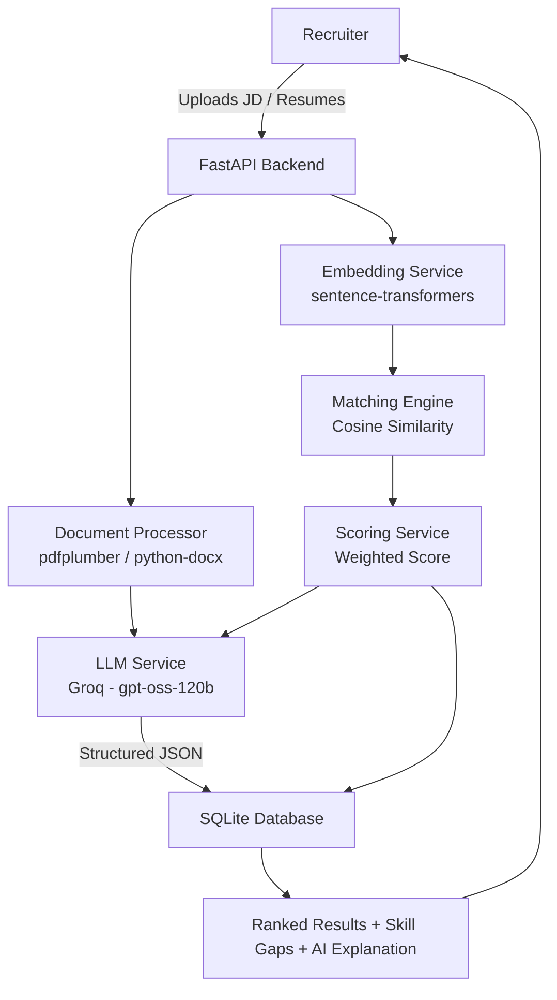

# AI Recruitment & Candidate Matching Platform

## 1. Project Overview
An AI-powered recruitment platform that helps recruiters analyze job descriptions and candidate resumes, extract structured information, semantically match candidates against job requirements, calculate weighted match scores, rank candidates, identify skill gaps, and generate AI explanations of candidate suitability.

## 2. Problem Statement
Recruiters receive large volumes of resumes per job opening. Manually comparing each resume against a job description is slow and inconsistent. This system uses AI to understand both the job description and candidate resumes, compare them semantically (not just by keyword), and surface ranked, explainable recruitment insights.

## 3. Objectives
- Automate extraction of structured data from job descriptions and resumes
- Perform semantic (meaning-based) skill matching, not just exact keyword matching
- Generate a transparent, weighted match score per candidate
- Rank candidates and highlight skill gaps
- Provide AI-generated natural language explanations of fit

## 4. Features
- Upload job descriptions and resumes (PDF/DOCX)
- LLM-based structured extraction (skills, experience, education, projects, certifications)
- Embedding-based semantic matching (FAISS + Sentence-Transformers)
- Weighted candidate scoring (Skills 40%, Experience 25%, Projects 20%, Education 10%, Additional Skills 5%)
- Candidate ranking per job
- Skill gap analysis (matching vs missing skills)
- AI-generated explanation of candidate suitability
- Structured JSON API responses throughout
- Robust error handling (invalid files, missing data, LLM/API failures)

## 5. Technology Stack
- **Backend**: FastAPI, Uvicorn
- **LLM**: Groq API (openai/gpt-oss-120b)
- **Embeddings**: sentence-transformers (all-MiniLM-L6-v2)
- **Semantic Search**: FAISS / cosine similarity
- **Database**: SQLite via SQLAlchemy
- **Document Parsing**: pdfplumber (PDF), python-docx (DOCX)
- **Config Management**: python-dotenv

## 6. System Architecture



## 7. Application Workflow
1. Recruiter uploads a Job Description → text extracted → LLM extracts required skills/experience/education
2. Recruiter uploads candidate resumes against that job → text extracted → LLM extracts candidate profile
3. `/match/{job_id}` is called → embeddings generated for job requirements and candidate data → semantic similarity computed → weighted score calculated → AI explanation generated → results ranked and stored
4. Recruiter reviews ranked candidates, skill gaps, and explanations via `/ranking/{job_id}` or `/candidates`

## 8. Resume Processing Approach
- Files are validated by extension (.pdf, .docx only)
- Text is extracted using `pdfplumber` (PDF) or `python-docx` (DOCX)
- Corrupted or empty documents are caught and rejected with clear error messages before reaching the LLM

## 9. LLM Usage
The Groq API (`openai/gpt-oss-120b`) is used for two extraction tasks:
- **Job description → structured requirements** (required skills, experience, education)
- **Resume → structured candidate profile** (name, skills, experience, education, projects, certifications)

A third LLM call generates a short natural-language explanation of each candidate's fit during matching. All LLM outputs are requested as strict JSON and parsed defensively (invalid JSON or API failures return clean HTTP errors instead of crashing).

## 10. Embedding Approach
Candidate skills and job requirements are converted into vector embeddings using `all-MiniLM-L6-v2` (via `sentence-transformers`). Cosine similarity between vectors is used to detect semantic matches — e.g., a resume mentioning "FastAPI and Django" is correctly matched against a requirement for "Python backend development" even without shared keywords.

## 11. Matching Methodology
For each required skill, the system compares it against every candidate skill using semantic similarity and keeps the best match. A skill is considered "matched" if similarity exceeds a threshold (0.6). This produces explicit matching and missing skill lists per candidate.

## 12. Scoring Methodology
Weighted final score:

| Category | Weight |
|---|---|
| Required Skills | 40% |
| Relevant Experience | 25% |
| Projects | 20% |
| Education/Certifications | 10% |
| Additional Skills | 5% |

- **Skills score**: proportion of required skills semantically matched
- **Experience score**: semantic similarity between required and candidate experience text
- **Projects score**: semantic similarity between required skills and candidate project descriptions
- **Education score**: semantic similarity between required and candidate education
- **Additional skills score**: rewards extra relevant skills beyond requirements (capped)

Final score = weighted sum, expressed as a percentage.

## 13. API Documentation
| Method | Endpoint | Description |
|---|---|---|
| POST | `/jobs` | Upload a job description; extracts requirements via LLM |
| GET | `/jobs` | List all jobs |
| POST | `/resumes` | Upload a candidate resume against a job; extracts profile via LLM |
| POST | `/match/{job_id}` | Run scoring + ranking + AI explanation for all candidates of a job |
| GET | `/ranking/{job_id}` | Get the stored ranking for a job |
| GET | `/candidates` | List all candidates (optional `job_id` filter) |
| GET | `/candidates/{candidate_id}` | Get one candidate's full profile and score |

Full interactive documentation available at `/docs` (Swagger UI) when the server is running.

## 14. Installation
```bash
git clone <your-repo-url>
cd dstarix-recruitment-matcher
python -m venv venv
venv\Scripts\Activate.ps1      # Windows
pip install -r requirements.txt
```

## 15. Environment Variables
Create a `.env` file in the project root:
```
GROQ_API_KEY=your_groq_api_key_here
```

## 16. Running Instructions
```bash
uvicorn app.main:app --reload
```
Then open `http://127.0.0.1:8000/docs` for the interactive API documentation.

## 17. Testing
Manually tested scenarios (via Swagger UI):
- ✅ Valid JD upload with successful LLM extraction
- ✅ Valid resume upload with successful LLM extraction
- ✅ Unsupported file format upload → clean 400 error
- ✅ Resume uploaded against non-existent job_id → clean 404 error
- ✅ Non-existent candidate lookup → clean 404 error
- ✅ Deprecated/invalid LLM model → clean 502 error (no crash)
- ✅ Full match/ranking pipeline with real semantic skill matching and gap analysis
- ✅ Multiple candidates ranked against the same job

## 18. Error Handling
Handled explicitly:
- Missing job title → 400
- Unsupported file format → 400
- Empty or corrupted document → 400
- Missing/invalid job_id on resume upload → 404
- No candidates found for matching → 404
- Non-existent candidate lookup → 404
- LLM API failure or invalid JSON response → 502/500 (caught, does not crash the app)

## 19. Known Limitations
- Skills/projects/certifications are stored as JSON strings in SQLite rather than normalized relational tables (documented design tradeoff for project scope)
- Similarity threshold (0.6) is a fixed heuristic, not tuned against a labeled dataset
- No authentication/authorization layer (out of scope for this assignment)
- No frontend UI (currently tested via Swagger UI; a Streamlit interface could be added)

## 20. Future Improvements
- Add a lightweight Streamlit frontend for recruiter-facing use
- Store embeddings in a persistent vector index (FAISS index file) instead of recomputing per request
- Add authentication and multi-recruiter support
- Allow configurable scoring weights via API/config instead of hardcoded values
- Add automated test suite (pytest) instead of manual Swagger testing